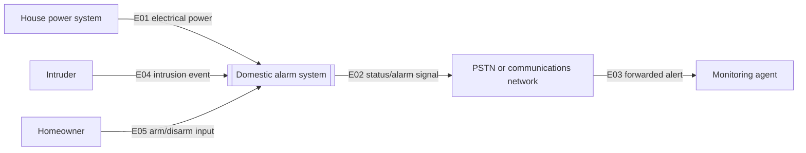

# Context Diagram Template

<!--
Use this template to define the system boundary and external interfaces.
Place the system of interest in the center. Show external systems explicitly. Name each interface.
Use the interface table to record ownership, direction, and assumptions.
-->

## Blank Mermaid context diagram

```mermaid
flowchart LR
  U1[External System A] -->|E01 [input]| SOI[[System of Interest]]
  SOI -->|E02 [output]| U2[External System B]
  U3[Environment/Actor] -->|E03 [interaction]| SOI
```

## Interface register

| Interface ID | External system | Direction | Exchange | Owner | Assumption/constraint |
|---|---|---|---|---|---|
| E01 | [name] | external -> soi | [data/material/energy/service] | [party] | [note] |

## Minimal example

Illustrative only; not a record of execution, approval, or measured performance.


