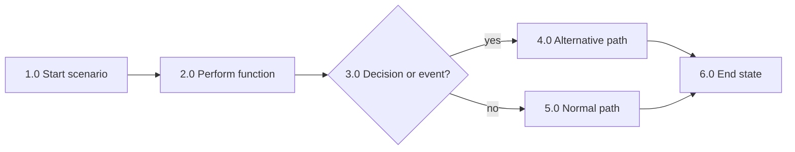
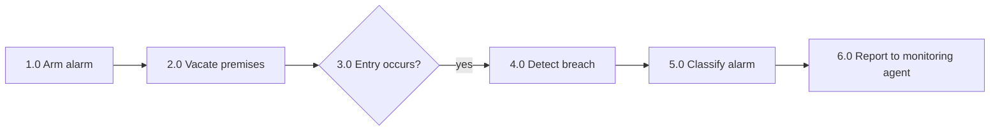

# Functional Flow Block Diagram (FFBD) Template

<!--
Use this template to capture sequence, branching, concurrency, and interface-sensitive behavior.
Number functions consistently with the RBS. Keep one level readable at a time.
Use the function table to capture inputs, outputs, and interfaces.
-->

## Blank Mermaid draft

## Function table

| Node | Function | Predecessor | Successor | Trigger/Input | Output | Interface/Actor |
|---|---|---|---|---|---|---|
| 1.0 | [function] | - | [node] | [input] | [output] | [interface] |

## Minimal example

Illustrative only; not a record of execution, approval, or measured performance.

