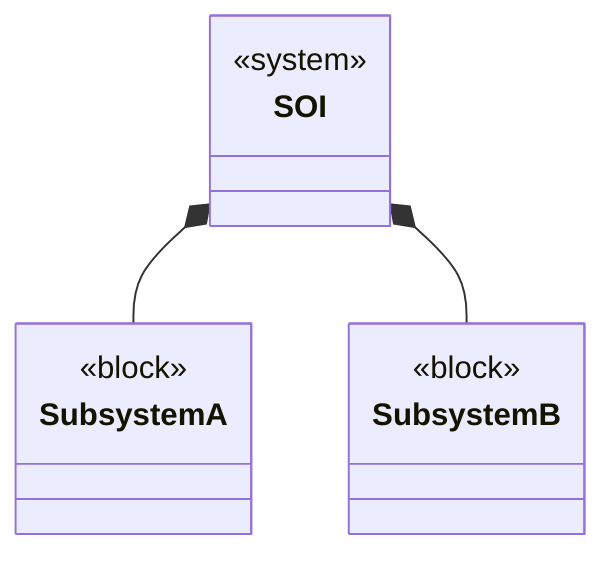
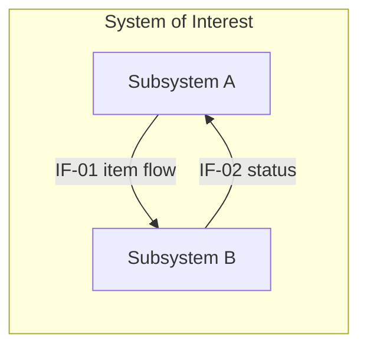
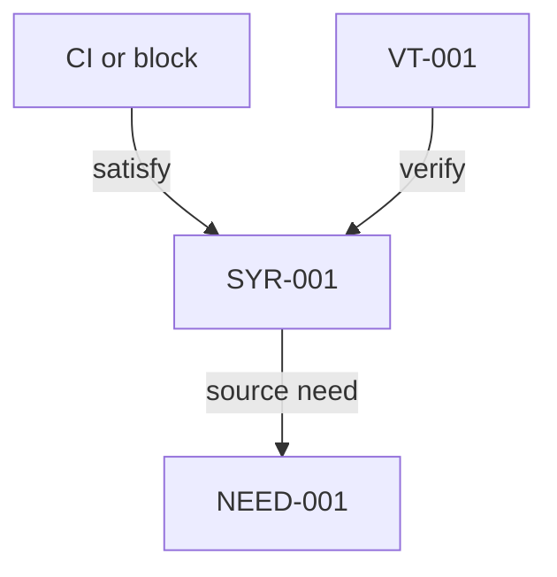
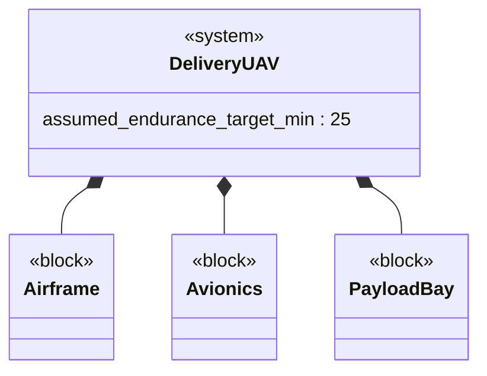
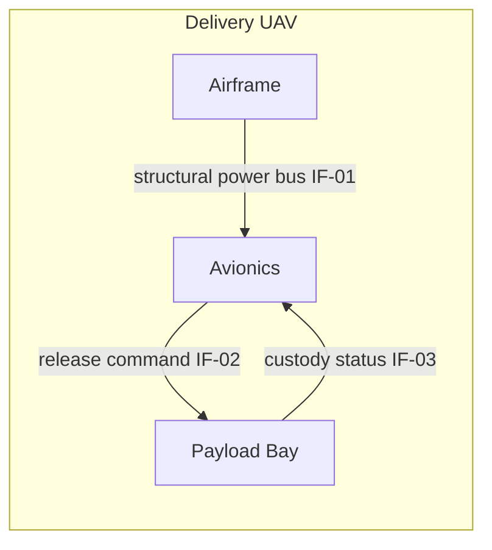

# SysML Model Views Template

<!--
Use this template to produce controlled SysML-style views in Mermaid.
BDD shows composition. IBD shows internal parts, ports, and flows.
Requirements diagram is a projection, not native SysML; declare relationship directions.
Keep names identical to the CI and requirement registers.
-->

## 1. Model frame
- System of interest:
- Abstraction level:
- Baseline / approval state:
- Notation convention and limits: illustrative Mermaid, not a native SysML export.
- Numeric properties: distinguish specified targets from demonstrated values.
- Model elements in scope:

## 2. Block definition diagram (BDD)

## 3. Internal block diagram (IBD)

## 4. Requirements diagram

## 5. Model register

| Element | SysML kind | Parent | Ports / connectors | Linked req | Notes |
|---|---|---|---|---|---|
| [name] | [system/block/itemFlow/requirement/test] | [parent] | [ids] | [ids] | [note] |

## 6. N2 sketch (optional)

|  | A | B | C |
|---|---|---|---|
| A | A | [A->B] | [A->C] |
| B | [B->A] | B | [B->C] |
| C | [C->A] | [C->B] | C |

## Minimal example

Illustrative only; not a record of execution, approval, or measured performance.

