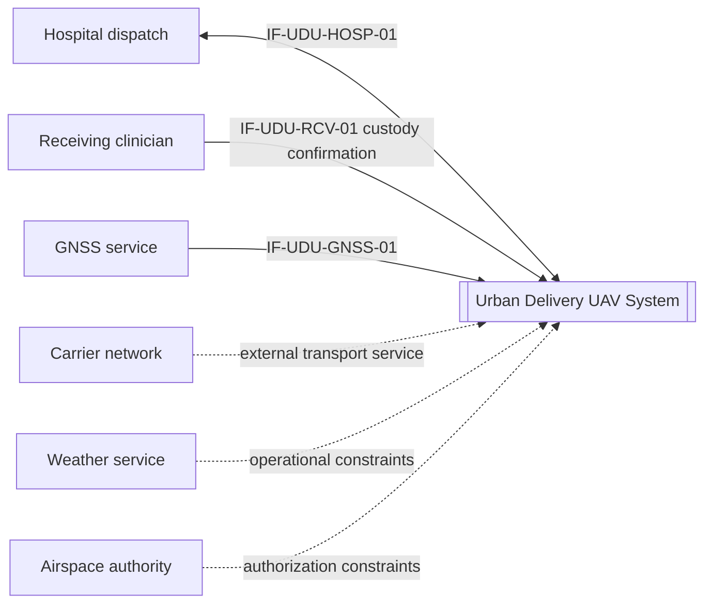
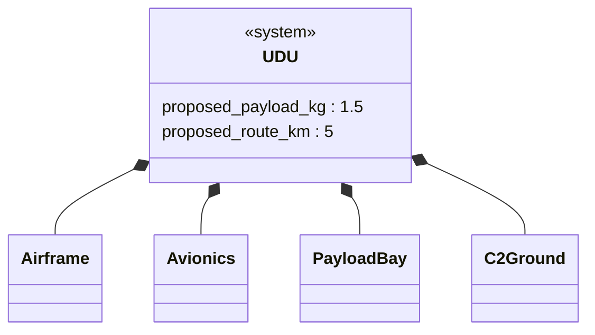
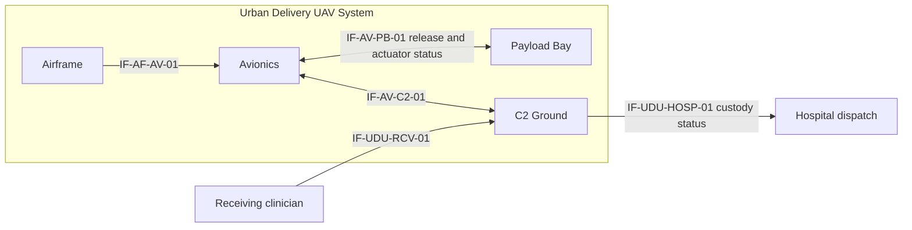
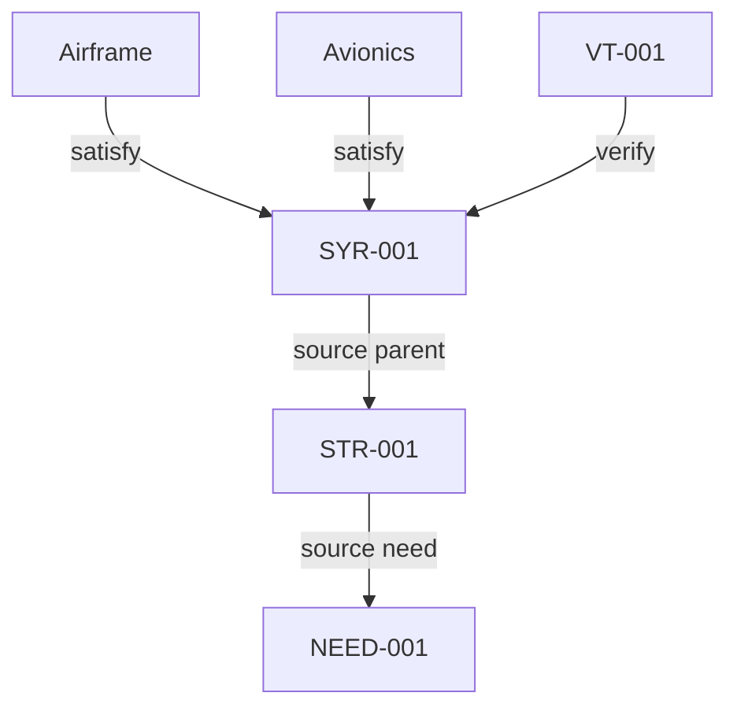

# Worked example - urban delivery UAV (not an executed E2E evaluation)

Lifecycle: conceptual design. SOI: Urban Delivery UAV System (UDU).
Mission: explore delivery of a 1.5 kg medical parcel over a 5 km urban route in daylight.
All requirements, ratings, test IDs, and numeric targets here are illustrative, not measured,
not supplied by an actual hospital, and not approved by a regulator. No flight or agent trial
has been executed by this fixture. Approval state is draft throughout.

## 1. Source and environment

| Source ID | Description | Origin | Locator |
|---|---|---|---|
| SRC-UAV-001 | Authored training scenario and assumptions | illustrative | This file, requirements, environment, and change note |

ENV-UAV-01: dry daylight; wind <= 8 m/s; 5 km route; 1.5 kg parcel; named approved corridor,
geo-fence definition, navigation-error treatment, and operating authorization still to be supplied.
The test matrix must cover agreed normal/degraded cases; flight testing requires separate safety
and operational approvals. No claim of jurisdictional permission is made.

CR-001 (illustrative clarification, approval pending): the original SYR-002 required a
"custody-complete" status within 5 seconds of **landing**. Landing does not establish clinician
custody. The proposed statement below starts the clock at confirmed custody. Retain the original
until a stakeholder approves the change; this example does not silently approve a project change.
If the real requirement must remain landing-triggered, define a truthful landed status or resolve
the custody timing constraint, then change its verification procedure through control.

## 2. Requirements ingestion

| ID | Type | Requirement statement | Source | Parent | Origin | Approval | Verification |
|---|---|---|---|---|---|---|---|
| NEED-001 | need | Reduce the last-mile medical delivery delay. | SRC-UAV-001 | none | illustrative | draft | validation |
| STR-001 | stakeholder | The receiving clinician shall obtain custody of a 1.5 kg parcel within 20 minutes of dispatch during dry daylight operations. | SRC-UAV-001 | NEED-001 | illustrative | draft | demonstration |
| SYR-001 | functional | The UDU shall complete a 5 km delivery of a 1.5 kg parcel within 20 minutes of dispatch in ENV-UAV-01. | SRC-UAV-001 | STR-001 | illustrative | draft | test |
| SYR-002 | interface | The UDU shall deliver custody-complete status to hospital dispatch over IF-UDU-HOSP-01 within 5 seconds of confirmed clinician custody. | SRC-UAV-001 | STR-001 | illustrative | draft | test |
| SYR-003 | safety | The UDU shall remain within the approved geo-fence in ENV-UAV-01. | SRC-UAV-001 | STR-001 | illustrative | draft | test |
| SYR-014 | derived interface | The Payload Bay shall complete an authorized release within 200 ms of receiving a valid release command when geo-fence is valid and inhibit is inactive. | SRC-UAV-001 | SYR-001 | illustrative | draft | test |
| SYR-015 | derived safety | The Payload Bay shall prevent release whenever geo-fence is invalid or the inhibit discrete is active. | SRC-UAV-001 | SYR-003 | illustrative | draft | test |
| SYR-016 | derived safety | The Payload Bay shall cause no mechanical release motion in response to an invalid command. | SRC-UAV-001 | SYR-001 | illustrative | draft | test |
| SYR-017 | derived interface | The Payload Bay shall return REJECTED status for an invalid command on IF-AV-PB-01. | SRC-UAV-001 | SYR-016 | illustrative | draft | test |

The lower-level payload obligations are proposed allocations/derivations, not quotations from
hospital stakeholders. Their parent links preserve rationale: delivery needs a release mechanism;
geofence safety drives an inhibit; invalid-command behavior limits unintended releases.

## 3. Architecture and interface definitions

| Element ID | Parent | Role |
|---|---|---|
| UDU | none | Urban Delivery UAV System |
| Airframe | UDU | flight structure and propulsion |
| Avionics | UDU | navigation and flight control |
| Payload Bay | UDU | controlled parcel release |
| C2 Ground | UDU | operator control, clinician confirmation, hospital messaging |

| Interface ID | Party A | Party B | Purpose | Requirement IDs |
|---|---|---|---|---|
| IF-AF-AV-01 | Airframe | Avionics | power/control exchange | SYR-001 |
| IF-AV-PB-01 | Avionics | Payload Bay | release command and actuator status, not clinician custody | SYR-014, SYR-015, SYR-016, SYR-017 |
| IF-AV-C2-01 | Avionics | C2 Ground | logical internal C2/telemetry over external carrier | SYR-001, SYR-003 |
| IF-UDU-HOSP-01 | C2 Ground | Hospital dispatch | mission and custody-status exchange | SYR-002 |
| IF-UDU-RCV-01 | Receiving clinician | C2 Ground | authenticated custody confirmation; protocol open | SYR-001, SYR-002 |
| IF-UDU-GNSS-01 | GNSS service | Avionics | position/time input; integrity assumptions open | SYR-003 |

External systems: hospital dispatch, receiving clinician, GNSS service, carrier network, weather
service, and airspace authority. The external carrier transports an internal logical interface;
it does not make the C2 Ground CI external to the UDU.

## 4. Trade study

Mandatory targets are the proposed payload, route, delivery time, geo-fence behavior, and actual
legal/safety authorization. No vendor data, trial-corridor permission, reserve margin, budget, or
schedule limit has been supplied. Therefore none of the three options is proven compliant.

| Criterion ID | Mandatory requirement / threshold | Candidate | Value / condition | Source / basis | Gate result | Disposition |
|---|---|---|---|---|---|---|
| GATE-UAV-01 | 1.5 kg; 5 km; <= 20 min; geo-fence; approved operation | COTS multicopter | unknown | supplier data and authorization missing | unknown | pending |
| GATE-UAV-01 | same agreed mandatory set | MOTS VTOL | unknown | supplier data and authorization missing | unknown | pending |
| GATE-UAV-01 | same agreed mandatory set | New development | unknown | design and authorization missing | unknown | pending |

### Pugh matrix

The ratings and weights below are explicitly assumed for a methods exercise (SRC-UAV-001).
They do not demonstrate commercial performance, lead time, endurance reserve, or data rights.
Higher endurance/integration/support capability and lower cost/time/risk are preferred.

| Criterion | Weight | Datum: COTS multicopter | MOTS VTOL | New development |
|---|---|---|---|---|
| Endurance margin | 5 | S | + | + |
| Payload integration | 4 | S | + | + |
| Cost | 4 | S | - | - |
| Schedule | 5 | S | - | - |
| Technical risk | 5 | S | S | - |
| Support / data rights | 3 | S | + | + |
| Count + |  | 0 | 3 | 3 |
| Count - |  | 0 | 2 | 3 |
| Net |  | 0 | 1 | 0 |
| Weighted net |  | 0 | 3 | -2 |

Provisional result: the illustrative weighted net favors MOTS VTOL (3), then the datum (0), then
new development (-2). This is not a selection: mandatory compliance is unknown for all options.
Reducing endurance weight from 5 to 2 makes MOTS tie the datum at 0; changing MOTS support from
+ to S also creates a tie. The preference is sensitive. Do not reject COTS for an undocumented
reserve or new development for an unstated schedule threshold. Obtain those requirements and
supplier/design evidence before a decision. Approval remains pending.

## 5. SysML-style projections (Mermaid, not native SysML)

Use dependency-style direction: implementing block -> requirement (satisfy), event -> requirement
(verify); source-need arrows indicate provenance. No executable model or conformance is claimed.

## 6. V&V / V-model

| Left-side product | Requirement IDs | Right-side activity | Method | Event ID |
|---|---|---|---|---|
| STR-001 / NEED-001 | NEED-001, STR-001 | validation; operational evaluation if authorized | demonstration | VAL-001 |
| SyRS | SYR-001, SYR-002, SYR-003 | system verification | test | VT-001, VT-002, VT-003 |
| Payload interface allocation | SYR-014, SYR-015, SYR-016, SYR-017 | interface/subsystem verification | test | VT-014 |

| Event ID | Requirement ID | Method | Procedure / setup | Success criteria | Environment / limitations | Expected evidence | Actual evidence | State | Result |
|---|---|---|---|---|---|---|---|---|---|
| VT-001 | SYR-001 | test | Record dispatch and confirmed custody timestamps on each authorized 5 km run with 1.5 kg payload | delivery <= 20 min | ENV-UAV-01; sample plan and authorization pending | FT-001 | none | planned | not-run |
| VT-002 | SYR-002 | test | Inject valid clinician confirmation and measure hospital receipt timestamps across IF-UDU-HOSP-01 | custody-status latency <= 5 s | ENV-COMMS-01: approved connected-service load/envelope, outage policy open | MSG-002 | none | planned | not-run |
| VT-003 | SYR-003 | test | Exercise boundary and degraded-navigation cases against approved geo-fence; validate position uncertainty treatment | zero geo-fence violations in approved cases | ENV-UAV-01; representative matrix pending; not universal proof | GEO-003 | none | planned | not-run |
| VT-014 | SYR-014, SYR-015, SYR-016, SYR-017 | test | Isolated payload bench; valid/invalid commands and all geo-fence/inhibit combinations | <= 200 ms valid release; no prohibited motion; REJECTED invalid status | ENV-PB-01: defined command set and combinations; setup approval pending | PB-014 | none | planned | not-run |

| Validation ID | Stakeholder need | How we will know the need is met | Related verification events | Residual uncertainty | Expected evidence | Actual evidence | State | Result |
|---|---|---|---|---|---|---|---|---|
| VAL-001 | NEED-001, STR-001 | clinician custody <= 20 min for each of 10 proposed operational trials | VT-001, VT-002 | sample plan and stakeholder criterion unapproved; no reliability rate inferred | OT-001 | none | planned | not-run |

All events are plans only. ENV-COMMS-01 and ENV-PB-01 require quantitative project definitions
before execution. Planned coverage below is conditional on those draft envelopes and CR-001;
it is not a baseline-readiness declaration or product verification result.

### Requirement-obligation contract

This explicit transcription makes selected trace properties checkable. Independently review its
consistency with the requirement statements and eventual procedures; the checker cannot do that
engineering interpretation. "none" means no single controlled exchange is itself the obligation.

| Requirement ID | Obligation ID | Observable | Trigger | Interface ID | Comparator | Limit | Unit | Conditions |
|---|---|---|---|---|---|---|---|---|
| SYR-001 | OB-001 | delivery duration | dispatch -> confirmed custody | none | <= | 20 | min | ENV-UAV-01 |
| SYR-002 | OB-002 | custody-status latency | clinician confirmation -> hospital receipt | IF-UDU-HOSP-01 | <= | 5 | s | ENV-COMMS-01 |
| SYR-003 | OB-003 | geo-fence violations | approved flight case | none | == | 0 | count | ENV-UAV-01 |
| SYR-014 | OB-014 | release latency | valid command -> release | IF-AV-PB-01 | <= | 200 | ms | ENV-PB-01; valid geo-fence; inhibit inactive |
| SYR-015 | OB-015 | prohibited release motion | invalid geo-fence or active inhibit | IF-AV-PB-01 | == | 0 | count | ENV-PB-01; all gate combinations |
| SYR-016 | OB-016 | invalid-command release motion | invalid command | IF-AV-PB-01 | == | 0 | count | ENV-PB-01; invalid command cases |
| SYR-017 | OB-017 | invalid-command response | invalid command | IF-AV-PB-01 | == | REJECTED | state | ENV-PB-01; invalid command cases |

### Event-check contract

| Event ID | Requirement ID | Obligation ID | Observable | Trigger | Interface ID | Comparator | Limit | Unit | Conditions |
|---|---|---|---|---|---|---|---|---|---|
| VT-001 | SYR-001 | OB-001 | delivery duration | dispatch -> confirmed custody | none | <= | 20 | min | ENV-UAV-01 |
| VT-002 | SYR-002 | OB-002 | custody-status latency | clinician confirmation -> hospital receipt | IF-UDU-HOSP-01 | <= | 5 | s | ENV-COMMS-01 |
| VT-003 | SYR-003 | OB-003 | geo-fence violations | approved flight case | none | == | 0 | count | ENV-UAV-01 |
| VT-014 | SYR-014 | OB-014 | release latency | valid command -> release | IF-AV-PB-01 | <= | 200 | ms | ENV-PB-01; valid geo-fence; inhibit inactive |
| VT-014 | SYR-015 | OB-015 | prohibited release motion | invalid geo-fence or active inhibit | IF-AV-PB-01 | == | 0 | count | ENV-PB-01; all gate combinations |
| VT-014 | SYR-016 | OB-016 | invalid-command release motion | invalid command | IF-AV-PB-01 | == | 0 | count | ENV-PB-01; invalid command cases |
| VT-014 | SYR-017 | OB-017 | invalid-command response | invalid command | IF-AV-PB-01 | == | REJECTED | state | ENV-PB-01; invalid command cases |

## 7. FMEA

All ratings are assumed 1-10 exercise values, not calibrated domain scales. Both failures need
safety review because of their effects, independently of RPN. No universal action cutoff is used.
S remains unchanged in the projected figures because the end effects have not been shown to change.

| ID | Item | Failure mode | S | O | D | RPN | Mitigation | Residual S | Residual O | Residual D | Residual RPN | Residual basis | Evidence | Linked req |
|---|---|---|---|---|---|---|---|---|---|---|---|---|---|---|
| FM-001 | propulsion | motor stop with hazardous descent | 9 | 4 | 6 | 216 | evaluate independent propulsion/energy and prove remaining control margin | 9 | 2 | 4 | 72 | projected | none | SYR-001 |
| FM-002 | geo-fence | keep-in fault with airspace departure | 8 | 3 | 4 | 96 | evaluate independent monitor and inhibit with proven response timing | 8 | 2 | 3 | 48 | projected | none | SYR-003 |

FM-001: assumed O improves 4 -> 2 and D 6 -> 4 only if the proposed controls work; 9*2*4=72 is a
forecast, not demonstrated mitigation. FM-002: 8*2*3=48 is equally provisional. Current ratings
and proposed changes need domain-specific evidence, common-cause review, and approved scales.
The propulsion lead and safety lead own the actions respectively; effectiveness and residual-risk
acceptance are OPEN at the next design review. No risk is closed by these arithmetic results.

## 8. ICD extracts

IF-AV-PB-01: Party A is Avionics; Party B is Payload Bay. A->B carries release commands; B->A
returns actuator status. Command-to-release <= 200 ms applies to a valid permitted command.
Release is inhibited unless geo-fence is valid AND inhibit is inactive. An invalid command causes
no release motion and returns REJECTED. Verification: VT-014. Linked requirements: SYR-014,
SYR-015, SYR-016, SYR-017. This bench interface does not verify hospital messaging.

IF-UDU-HOSP-01: Party A is C2 Ground; Party B is hospital dispatch. UDU->hospital carries
custody-complete status following confirmed clinician custody, with <= 5 s latency in the proposed
connected-service envelope. Verification: VT-002. Linked requirement: SYR-002. Authentication,
message schema, clock uncertainty, retries, and degraded-network behavior are open design items.

## 9. Traceability

| Need ID | Requirement ID | Architecture / CI | Interface ID | Test / V&V event | Method | Coverage |
|---|---|---|---|---|---|---|
| NEED-001 | SYR-001 | Airframe, Avionics, Payload Bay, C2 Ground | none | VT-001 | test | planned |
| NEED-001 | SYR-002 | C2 Ground | IF-UDU-HOSP-01 | VT-002 | test | planned |
| NEED-001 | SYR-003 | Avionics, C2 Ground | none | VT-003 | test | planned |
| NEED-001 | SYR-014 | Avionics, Payload Bay | IF-AV-PB-01 | VT-014 | test | planned |
| NEED-001 | SYR-015 | Avionics, Payload Bay | IF-AV-PB-01 | VT-014 | test | planned |
| NEED-001 | SYR-016 | Avionics, Payload Bay | IF-AV-PB-01 | VT-014 | test | planned |
| NEED-001 | SYR-017 | Avionics, Payload Bay | IF-AV-PB-01 | VT-014 | test | planned |

Within the seven explicitly declared system/allocation obligations: 7 have a conditional draft
plan; 0 have executed, checked passing, or accepted evidence. No declaration of universal
completeness is made: detailed safety, networking, environmental and support requirements remain
outside this abbreviated example. All source/parent IDs resolve inside the displayed register.

## 10. SEMP / ConOps and open decisions

ConOps: hospital dispatch authorizes a proposed mission; the UDU flies only within an approved
corridor; the clinician confirms custody; the C2 Ground CI reports status to hospital dispatch.
Landing, payload-actuator release, and clinician custody are different events. Night and heavy
rain are outside the illustrative first increment.

SEMP: incremental development. Propose a functional-baseline review after source and requirement
approval; an allocated-baseline review after supported trades and interface resolution; then
controlled development, integration, verification and operational validation. A named project
configuration authority must record decisions; no actual board meeting or approval is implied.

Open before any real baseline/flight: CR-001 approval; jurisdiction and corridor authorization;
mission reserve and schedule bounds; supplier evidence; ENV definitions and sample plans; payload
safety requirements; network outages; FMEA scales, verification of mitigations, and risk acceptance.
